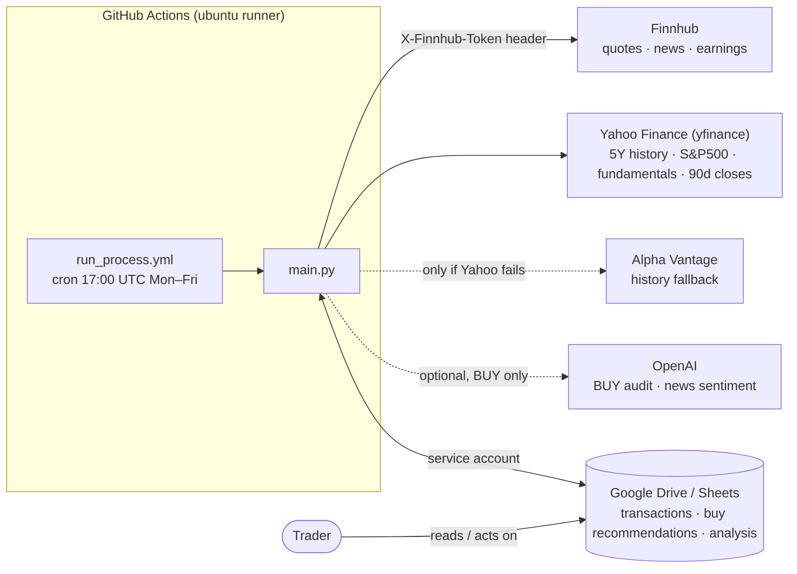
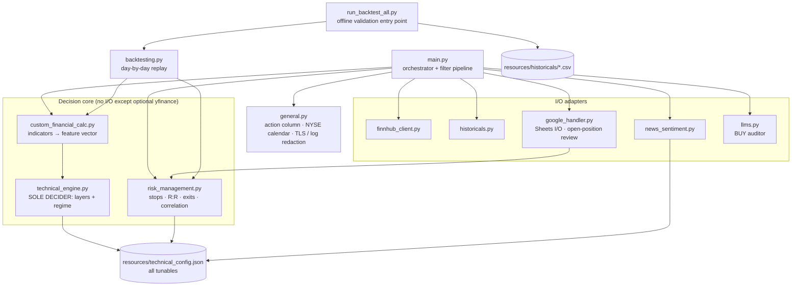
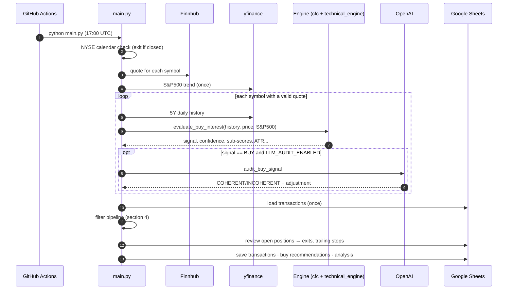
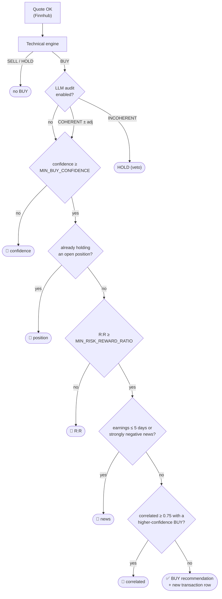
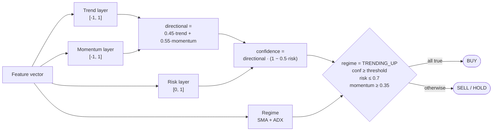
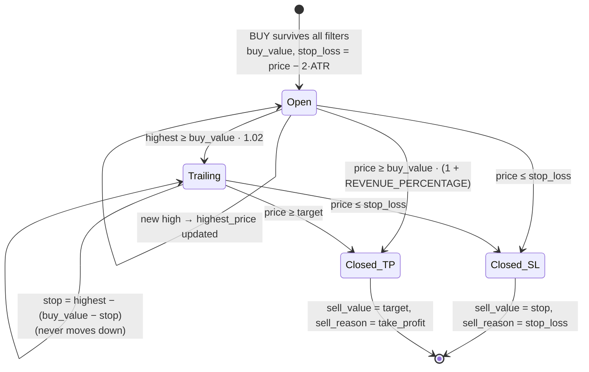
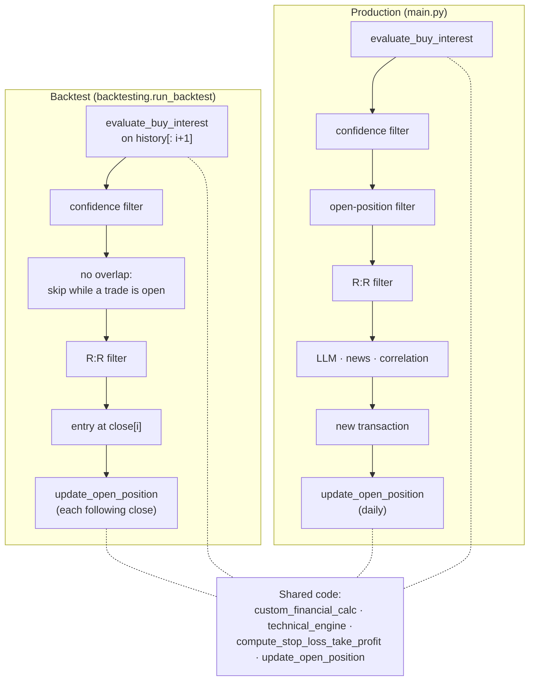
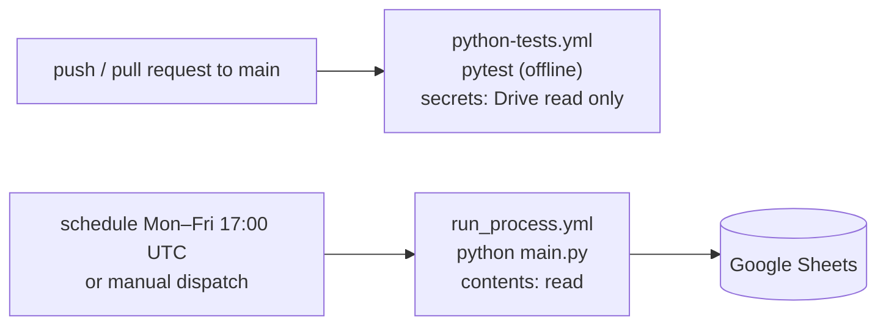

# Architecture

This document describes the **system-level** architecture of Trading Advisor:
what runs, when, against which external services, how a signal becomes a
position, and how the backtester replays production. Engine internals
(indicator maths, layer weights, regime rules, LLM prompt) are documented in
[`resources/doc/`](../resources/doc/README.md) and are only summarised here.

> **Core principle.** The deterministic technical engine is the sole decider.
> The LLM can only *audit* a BUY: veto it (BUY → HOLD) or nudge its confidence
> within `[-0.3, +0.1]`. It never creates or reclassifies a signal.

---

## 1. System context

Trading Advisor is a batch job. Once per US trading day, GitHub Actions runs
`main.py`, which pulls market data, scores every symbol in the interest list,
manages open positions, and writes three Google Sheets. There is no server and
no database: the Sheets are the system of record.



| External service | Used for | Called from | Failure behaviour |
|---|---|---|---|
| Finnhub | Live quote per symbol; company news; earnings calendar | `finnhub_client`, `news_sentiment` | Symbol skipped (quote) or filter skipped (news) |
| Yahoo Finance | 5-year daily history; S&P500 trend (once per run); P/B valuation; 90-day closes for correlation | `historicals`, `custom_financial_calc`, `risk_management` | Falls back to Alpha Vantage (history) or neutral values |
| Alpha Vantage | Daily history fallback | `historicals` | Symbol skipped |
| OpenAI | BUY audit (`LLM_AUDIT_ENABLED`); news sentiment (`NEWS_SENT_ANALYSIS`) | `llms`, `news_sentiment` | Audit fails **conservative** (veto); sentiment → NEUTRAL |
| Google Drive | Read/write the three Sheets as CSV | `google_handler` | Transactions update skipped; outputs logged as failed |

Finnhub's free plan covers **US exchanges only**; non-US tickers return zeros
and are skipped.

---

## 2. Code structure



**Boundaries that matter:**

- **Calculation vs. judgement.** `custom_financial_calc.py` computes indicators;
  `technical_engine.py` turns them into a decision. Keep maths out of the engine
  and thresholds out of the calculator.
- **Exits live in one function.** `risk_management.update_open_position` is the
  only implementation of trailing stop / stop-loss / take-profit. Production
  (`google_handler.update_transactions`) and the backtester both call it.
- **Config over code.** Weights, thresholds, ATR multipliers, correlation and
  news limits live in `technical_config.json`. Deployment-time knobs are env
  vars (section 8).

---

## 3. Daily run



The cron fires at 17:00 UTC, which is mid-session in New York, so the quote is
an intraday price, not the close.

---

## 4. Signal → recommendation pipeline

Every symbol gets a row in the **analysis** sheet with a `filter_status`
explaining exactly where it stopped. Only rows that survive every stage reach
the **buy recommendations** sheet and become new rows in **transactions**.



| Stage | Where | Input | Notes |
|---|---|---|---|
| Engine | `technical_engine.decide` | Feature vector | BUY only in regime `TRENDING_UP`, with momentum, risk and confidence gates |
| Valuation | `custom_financial_calc` | P/B from yfinance | Adds −0.05…+0.07 to confidence **after** the decision |
| LLM audit | `llms.audit_buy_signal` | Indicators + sub-scores | Veto or bounded adjustment; an API error is treated as a veto |
| Confidence | `main.filter_buys_by_confidence` | Audited confidence | Same env var as the engine's BUY threshold |
| Position | `main.main` | Transactions sheet | One open position per symbol |
| R:R | `main.filter_buys_by_risk_reward` | `compute_stop_loss_take_profit` | Stop 2×ATR; target min(REVENUE_PERCENTAGE, 3×ATR) |
| News | `news_sentiment.evaluate_news_filter` | Finnhub calendar/news, GPT | The earnings check always runs; sentiment only with `NEWS_SENT_ANALYSIS=true` |
| Correlation | `risk_management.filter_correlated_buys` | 90-day returns | Greedy: keeps the highest confidence, drops correlated lower ones |

### Engine in one picture



Details: [indicators and layers](../resources/doc/02_indicators_and_layers.md) ·
[regime and decision](../resources/doc/03_regime_and_decision.md) ·
[LLM audit](../resources/doc/04_llm_audit.md).

---

## 5. Position lifecycle

A row in the transactions sheet **is** a position. A position is open while
`sell_value` is empty. Every daily run reviews each open position with the
current price, including symbols no longer in the interest list (their price
is fetched from Finnhub).



- There is **no time exit**. A position stays open until the stop or the target is hit.
- The trailing distance is `buy_value − current stop`. Once the stop has risen
  above `buy_value`, that distance is negative and the stop stops moving. In
  practice it acts as a breakeven lock. This is the current production
  behaviour; a fixed-distance variant is an open experiment (see
  [`BACKTEST_LOG.md`](BACKTEST_LOG.md)).
- Exits are recorded at the stop or target price, not at the actual market
  price. When the price gaps below the stop, the recorded result is optimistic.
- The log is capped at `TRANSACTIONS_MAX_RECORDS` newest rows. **Open positions
  are always kept**, whatever their age.
- A partially written row (`sell_value` set, `sell_date` empty) is repaired
  automatically and gets `sell_reason = repaired`.

---

## 6. Data model (Google Sheets)

| Sheet (env var) | Written | Key columns |
|---|---|---|
| Transactions (`GDRIVE_FILE_ID`) | Read + rewritten each run | `symbol, buy_value, buy_date, sell_value, sell_date, buy_sell_days_diff, percentage_benefit, stop_loss, take_profit, highest_price, risk_reward_ratio, tradingview_url, sell_reason` |
| Buy recommendations (`BUY_RECOMMENDATIONS_ID`) | Overwritten each run | Today's surviving BUYs with levels and TradingView URL |
| Analysis (`ANALYSIS_FILE_ID`) | Overwritten each run | One row per symbol: `action, technical_confidence, manual_financial_analysis, llm_opinion, decision_reason, filter_status, news_sentiment, earnings_soon, stop_loss, take_profit, risk_reward_ratio` |

Conventions:
- `buy_date` is Madrid time, `YYYY-MM-DD HH:MM`.
- `sell_date` is a Madrid date, `YYYY-MM-DD`.
- `take_profit` is informational: the ATR-capped target used for R:R. The actual
  exit target is `buy_value × (1 + REVENUE_PERCENTAGE)`.
- Text cells starting with `=` or `@` get a leading `'` before upload, so Sheets
  never evaluates them as formulas.

---

## 7. Backtest parity

The backtester is the quality gate for engine changes (AGENTS.md, Rule 1). It
only works as a gate if it measures what production does. So it **replays the
production pipeline with the same code**, one trading day at a time, from local
CSVs.



| Aspect | Production | Backtest |
|---|---|---|
| Decision engine | identical | identical |
| Confidence / R:R filters | env vars | same env vars, else `backtest` config section |
| Position rules | one per symbol, no buy on the exit day | same |
| Exits | `update_open_position` on the intraday price | `update_open_position` on the daily close |
| Weekly confirmation | on | on |
| **Not replayable** | LLM audit, news/earnings, correlation, valuation, live S&P500 | skipped / neutral (S&P500 fixed at NEUTRAL) |

Running it:

```bash
python run_backtest_all.py                 # production-equivalent run, ~4 min, offline
python run_backtest_all.py --max-hold 30   # experiment flags: --min-conf --min-rr --target --step-days --no-weekly
```

Symbols run in parallel processes; the result is identical to a serial run.
The first output line prints the resolved parameters, so every
[`BACKTEST_LOG.md`](BACKTEST_LOG.md) entry is reproducible.

---

## 8. Configuration

| Layer | Holds | Changed by |
|---|---|---|
| `resources/technical_config.json` | Engine weights, regime and decision thresholds, `risk_management` (ATR multipliers, trailing activation, correlation), `news_filter`, `backtest` defaults, LLM bounds | Pull request + backtest comparison |
| GitHub `vars` | `SYMBOLS_INTEREST_LIST`, `REVENUE_PERCENTAGE`, `MIN_BUY_CONFIDENCE`, `MIN_RISK_REWARD_RATIO`, `LLM_AUDIT_ENABLED`, `NEWS_SENT_ANALYSIS`, `FORCE_OPINION`, `GPT_MODEL_NAME`, `TRANSACTIONS_MAX_RECORDS`, `LOG_LEVEL` | Repository settings |
| GitHub `secrets` | `FINNHUB_API_KEY`, `OPENAI_API_KEY`, `ALPHA_API_KEY`, `GDRIVE_CREDENTIALS_JSON`, Sheet IDs | Repository settings |
| Local `.env` | Same names, for local runs (git-ignored) | Developer |

`MIN_BUY_CONFIDENCE` is deliberately one knob for two things: the engine's BUY
threshold and the post-audit confidence filter. Full list:
[`.agent/instructions/env_vars.md`](../.agent/instructions/env_vars.md).

---

## 9. CI/CD and security



- **Tests are offline.** `test/conftest.py` stubs the yfinance valuation and
  S&P500 calls, and the external clients are mocked. Two Drive integration
  tests run only when credentials are present.
- **Least privilege.** Both workflows have `contents: read`. The test job only
  receives the Drive credentials, which it uses for read-only checks.
- **Secrets in transit.** TLS verification is on everywhere; the opt-out is
  `DISABLE_SSL_VERIFY`, for broken certificate chains only. Finnhub is
  authenticated by header, so the key never appears in a URL.
- **Secrets in logs.** `general.SecretRedactingFilter` replaces the values of
  `FINNHUB_API_KEY`, `OPENAI_API_KEY`, `ALPHA_API_KEY` and
  `GDRIVE_CREDENTIALS_JSON` with `***` in every log record. This covers
  Alpha Vantage, whose API only accepts the key as a URL parameter.
- **LLM input.** News headlines are untrusted text sent to the model. The worst
  outcome is a blocked BUY, since the LLM can only veto, so a prompt injection
  cannot create a trade.

---

## 10. Known limitations

- **Intraday bar.** The run happens mid-session, so the last history bar is
  partial: volume is incomplete and the candlestick patterns are unreliable.
- **Backtest gaps.** The LLM, news, correlation, valuation and live S&P500 are
  not replayed (section 7).
- **Market calendar.** It knows the regular NYSE holidays, not ad-hoc closures.
  Half days count as normal trading days.
- **Exit accounting.** Fills are recorded at the stop or target price, which is
  optimistic on gaps (open experiment).
- **Dependencies.** Versions are lower-bounded but not pinned; yfinance changes
  frequently.
